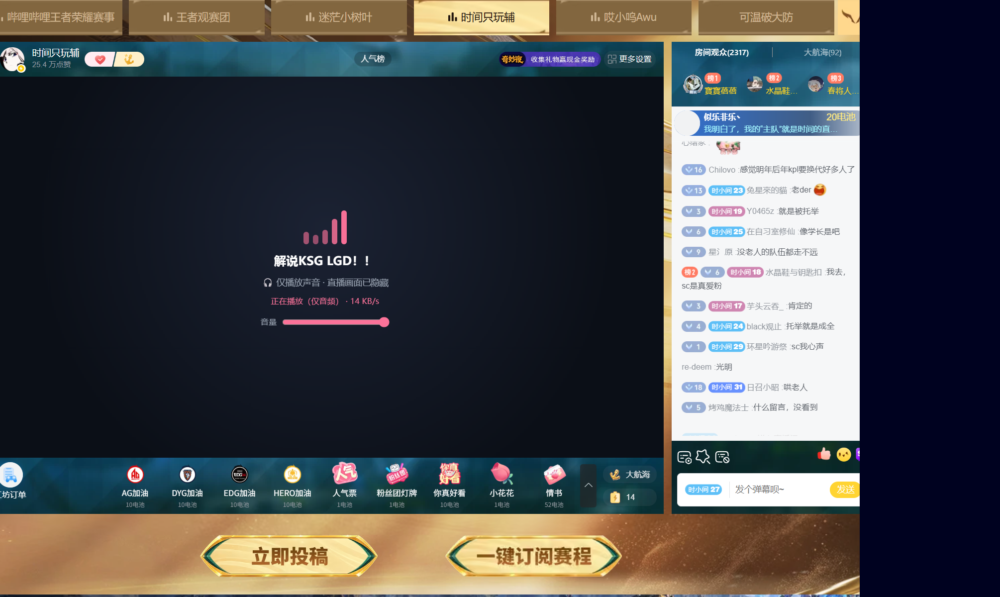

# B 站「仅播放声音」（bilibili-audio-only）

> 只下载音轨，不下载画面。点播省 **≈90%**，直播省 **≈80%**。

一个 Edge / Chrome 扩展（Manifest V3）。打开 B 站的视频页或直播间，打开开关，画面位置会变成一块音频界面，
而播放器**真的不会再下载视频数据**——不是把画面藏起来，是视频流根本没拉。

| 点播 | 直播 |
| --- | --- |
|  |  |

## 实测流量

同一台机器、同一个 CDN、前后相邻的测量窗口：

| 场景 | 正常播放 | 仅播放声音 | 省 |
| --- | --- | --- | --- |
| 点播（3 分钟 1080P） | 11.12 MB / 20 s | 1.06 MB / 20 s | **90.5%** |
| 点播（稳态） | ≈ 590 KB/s | ≈ 22 KB/s | ≈ 96% |
| 直播（KPL 赛事间） | 7.74 MB / 60 s | 1.32 MB / 60 s | **82%** |

点播的 20 秒窗口里两边都在预取（正常播放 20 秒就缓存了 50 秒画面），所以按秒数除会抬高正常播放的账面值；
稳态那行才是真实码率对比。

## 原理

### 点播：删掉清单里的视频轨

B 站的 DASH 把音轨和视频轨做成两条独立的 fMP4：

```
43216013298-1-30232.m4s   音轨  ~180 kbps
43216013298-1-100026.m4s  视频轨 ~4 Mbps
```

播放器只拉「清单里写了的东西」，而这份清单被**内嵌在页面的 `window.__playinfo__` 里**（正常加载时甚至看不到
`/x/player/wbi/playurl` 请求）。所以扩展在 `document_start` 给 `__playinfo__` 装一个 setter，页面脚本一赋值，
就把 `data.dash.video` 清空——播放器拿到的是纯音频清单，自然不会去下视频。

> 走过的弯路，写下来省得别人再踩：
> 1. **直接拦视频分片**（XHR 不发 `-1-300xx.m4s`）→ 流量归零，但播放器卡在 `readyState=0` 不动，因为 bpx 必须先把视频轨初始化好才 attach MSE。
> 2. **改 `/x/player/wbi/playurl` 的响应** → 白改，正常加载时那个请求根本不存在。

### 直播：用 `only_audio=1` 换一条纯音频流

直播和点播不一样：**一条流里 hvc1 + mp4a 是绑死的**（init 段 `trak=2`），媒体服务器默认不给纯音轨。

关键在于 `getRoomPlayInfo` 的这个参数——**它是调 API 时传的，不是改 URL**：

```
https://api.live.bilibili.com/xlive/web-room/v2/index/getRoomPlayInfo
  ?room_id=11058609&protocol=0,1&format=0&codec=0&qn=10000
  &platform=web&ptype=8
  &only_audio=1
```

服务端返回的 URL 里 `media_type` 还是 0，但**发出去的 stream key 已经是音频流的**：拉回来的 FLV 里
只有 `type=8`（音频）标签，`type=9`（视频）0 个。对照组（不带 `only_audio`）音频 93 个 + 视频 60 个。

浏览器不能直接播 FLV，所以：

1. `fetch` 这条 FLV（跨域是通的）；
2. 按 FLV tag 拆包（11 字节头 + 数据 + 4 字节尾）；
3. AAC 帧交给 **WebCodecs `AudioDecoder`**（配置来自 FLV 里的 AAC sequence header）；
4. 解码出的 PCM 用 **WebAudio** 排队播放，`GainNode` 控制音量；
5. 同时把页面上那个 `<video>` 一直按暂停——不按的话混流会照下，等于白省。

## 安装

1. 下载这个仓库（`git clone`，或右上角 Code → Download ZIP，或到 [Releases](https://github.com/Firefly-Star/bilibili-audio-only/releases) 下打包好的 zip 解压）；
2. 打开 `edge://extensions`（Chrome 用 `chrome://extensions`）；
3. 打开右上角「开发人员模式」；
4. 点「加载解压缩的扩展」，选择**本仓库根目录**（含 `manifest.json` 的那一层）。

## 使用

### 开关在哪

工具栏上的扩展图标 → 弹窗里一个复选框。**切换后页面会自动重载一次**。

- **点播页**：默认开启，装完就能用
- **直播页**：默认关闭，需要手动打开（它要接管播放器）

### 点播页看到什么

画面区域会变成深色背景 + 跳动的粉色电平条：

```
        ▮▮ ▮ ▮▮
   【视频标题】

  🎧 仅播放声音 · 画面已关闭，只加载音轨
  正在播放（仅音频） · 45 KB/s
```

播放/暂停、进度、音量**还是用播放器自己的控制条**（画面下方那条），扩展没有改动它们。

### 直播页看到什么

同样的深色背景 + 电平条，多一个**音量条**（直播是扩展自己解码播放的，原生播放器已经被暂停）：

```
        ▮▮▮ ▮▮
   解说 KSG LGD！！

  🎧 仅播放声音 · 直播画面已隐藏
  正在播放（仅音频） · 14 KB/s
  音量 ────●────
```

- 直播页那个"暂停"是**故意的**：只有把原播放器暂停，那条音视频混流才会停止下载。
- **第一次打开如果没有声音，点一下播放器区域**——浏览器的自动播放策略要求 `AudioContext`
  先拿到一次用户手势，拿到之后就一直有声音了。
- 弹幕、聊天、送礼都正常，它们走的是另外的接口。

### 想回到画面

点工具栏图标 → 取消勾选 → 页面自动重载 → 回到正常播放。

### 几点说明

- 界面上的 `xx KB/s` 是**实测**下载速率（只统计音轨分片，60 秒滑动窗口），不是估算；
  播放器预取时会飙到几十~上百，缓冲满了会显示「已缓冲（暂停下载）」。
- 开关状态存在站点的 `localStorage` 里，同一个浏览器下下次打开还是这个设置。
- 关掉开关必须重载页面才能生效（播放清单在页面加载时就被消费掉了）。
## 目录结构

```
manifest.json    MV3 清单
main.js          点播核心：__playinfo__ setter + 音频分片字节统计（world:MAIN）
isolated.js      点播 UI：音频动画 + 实时 KB/s + 开关消息
live-audio.js    直播核心：only_audio 取流 + FLV 拆包 + WebCodecs 解码 + WebAudio 播放（world:MAIN）
live.js          直播 UI：音频动画 + 状态 + 音量条
content.css      两页共用的界面样式
popup.html/js    工具栏弹窗开关
```

## 已知限制

- 只匹配 `www.bilibili.com/video/*` 和 `live.bilibili.com/*`；番剧（`/bangumi/play/*`）、直播回放、首页小窗播放都没测。
- 切换清晰度、分 P 切换没逐项验证；切完如果画面回来了，重载一次即可。
- 关掉开关必须重载页面（`__playinfo__` 已经被播放器消费过了）。
- `only_audio` 是 B 站 App 在用的接口参数，**随时可能被服务端改掉**；改掉之后直播部分需要重新抓包定位。
- 弹幕照常拉取（另一路接口，量很小）。

## 免责声明

个人学习 / 自用项目，与哔哩哔哩官方无关。请遵守平台的服务协议，不要用于绕过会员或付费内容。

## License

[MIT](LICENSE)


